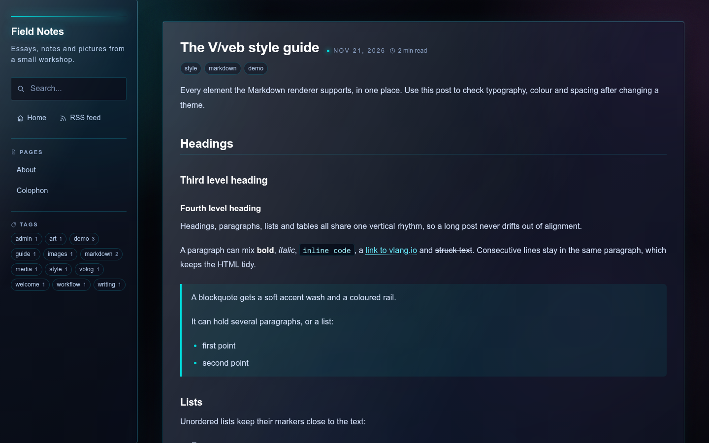
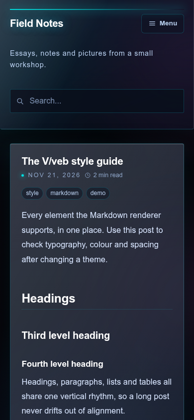
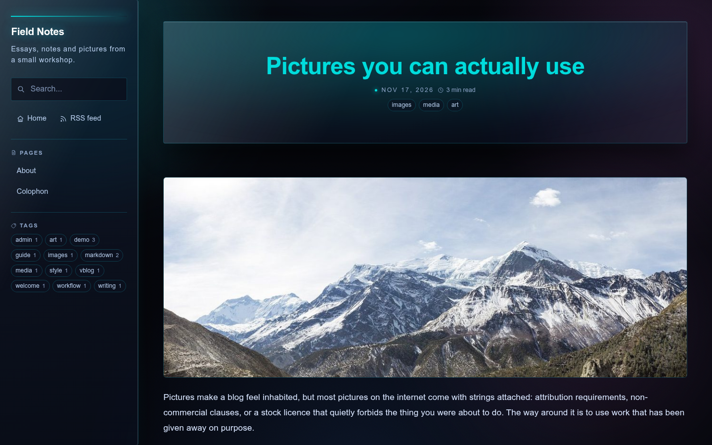
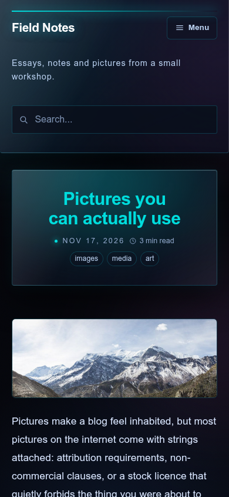
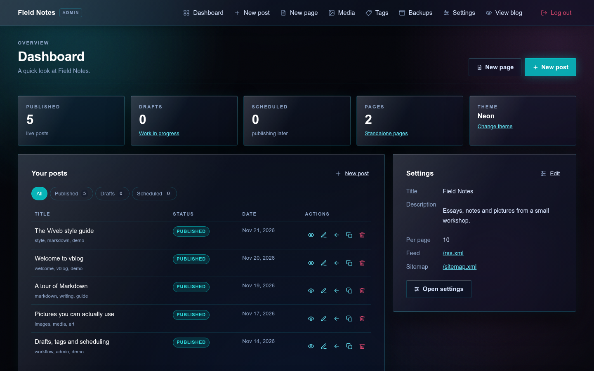
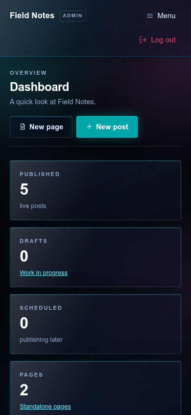

# vblog

**A fast, self-contained blog for a single author, written in [V](https://vlang.io) with [veb](https://github.com/vlang/veb).**

Posts and pages live in SQLite, uploads in a plain folder, and every page is
rendered on the server. No Node runtime, no build step on the server, and no
third-party requests at runtime: the CSS, JavaScript, fonts and icons all ship
with the binary.

> **Status: beta.** The feature set is in place and the blog is in daily use, but
> expect rough edges before 1.0. Backups are built in — take one before
> upgrading.

---

## Screenshots

Desktop and mobile, taken from the sample content a fresh install offers.

**Blog**

| Desktop | Mobile |
| --- | --- |
|  |  |

**Post**

| Desktop | Mobile |
| --- | --- |
|  |  |

**Dashboard**

| Desktop | Mobile |
| --- | --- |
|  |  |

---

## Features

**Writing**
- Markdown editor with a toolbar, live preview docked on the right, scroll-synced
  side-by-side editing and <kbd>Ctrl/⌘</kbd> + <kbd>S</kbd> to save
- Posts and pages, each with tags, per-item SEO title/description and Open Graph
  and Twitter meta tags
- Reading time, duplicate-to-draft, case-insensitive search across titles, bodies
  and tags
- Pages get their own address (`/pages/<id>`), appear in the sidebar, and any post
  can be promoted to a page

**Publishing**
- Drafts, instant publishing, and scheduled publishing with the exact wall-clock
  time the author typed
- A time zone setting (local server time, UTC, or any of ~40 IANA zones) drives
  schedules, the editor field, post dates and the confirmation toast, with
  daylight-saving changes handled
- RSS feed at `/rss.xml` and an XML sitemap at `/sitemap.xml`
- Tag cloud, `/tag/<tag>` archives and related posts on every article

**Media**
- Media library at `/media`: drag-and-drop uploads, search and file-type filters,
  per-file titles and alt text, copy-link, download, delete and a lightbox preview
- Uploads are stored in `media/` and served from `/media/<file>`; point that folder
  at a volume or bind mount to keep them outside the deployment
- Uploaded images, logos and favicons are validated by content, not by file name

**Design**
- Ten glass themes sharing one flush-left rail layout, each with its own palette,
  type and glass treatment: `default`, `glass`, `dark`, `sepia`, `ocean`, `noir`,
  `sakura`, `forest`, `neon` (the default) and `sunset`
- Blog title, description, logo, favicon, accent colour, footer text and per-area
  visibility switches, all editable from `/settings`
- Inline SVG icon set across the sidebar, admin navigation, dashboard, editor and
  post actions; styled scrollbars and form controls

**Operations**
- Backups at `/backups`: one-click snapshots of the database, `config.json` and
  `media/`, a scheduler from hourly to weekly, a retention limit, and a
  confirmation dialog before any restore
- `scripts/backup.sh` for cron or a shell, using `sqlite3 .backup` so the snapshot
  is consistent while the server is running
- Maintenance flags for truncating content, clearing media and resetting settings,
  each asking for confirmation first

**Security and privacy**
- One admin account, HttpOnly + SameSite cookies, same-origin checks on every
  mutating request and hardening headers on every page
- Uploaded SVG is validated before it is served and media responses are
  sandboxed; only the signed-in author can write posts
- All assets are local; nothing calls out to a CDN, analytics service or font host

---

## Requirements

| Requirement | Notes |
| --- | --- |
| [V](https://vlang.io) 0.5.2 or newer | Tested with 0.5.2; the time-zone support in the settings page needs a recent vlib |
| SQLite headers | `sudo apt install libsqlite3-dev` on Debian/Ubuntu, `brew install sqlite` on macOS |
| `sqlite3` CLI | Optional; needed by `scripts/backup.sh` and the shell-side backup workflow |
| Two V modules | Installed with `v install` in the next section |

The `veb` and `markdown` modules are declared in `v.mod`; install both before the
first build (V does not fetch them for you):

```sh
v install veb
v install markdown
```

---

## Quick start

### 1. Get the code and build

```sh
git clone [vblog](https://github.com/scurty-labs/vblog) vblog
cd vblog
v -prod .
```

`v -prod .` produces the `vblog` binary next to the source. For a development
build with symbols and faster compile times, use `v .`.

### 2. Run the first-start setup

```sh
./vblog
```

Setup only appears when `config.json` is missing. It asks for the admin account,
the port to listen on and then whether to import the sample content:

```text
──────────────────────────────────────────────────────────────
  vblog v0.2.0
  A fast, self-contained blog written in V.
──────────────────────────────────────────────────────────────

No config.json found, so this is the first run.
Two short steps and the blog is ready to serve.

[1/2] Create the admin account
  This is the only account. It signs in at /admin, once.

  at least 3 characters: letters, numbers, dot, dash or underscore
  Username: admin
  used for the admin account and the RSS feed
  Email: you@example.com
  at least 8 characters
  Password: ********
  Confirm password: ********

  One last thing: the port the blog listens on.
  Press Enter for 8082.

  Port [8082]: 8082

  Generating a salt and a session secret...

  Configuration saved to config.json.

  Admin sign-in   http://localhost:8082/admin
  Username        admin

  Keep config.json private: it holds your session key and password hash.

──────────────────────────────────────────────────────────────
[2/2] Sample content
  vblog can add four posts, two pages, their tags and five
  public-domain pictures, so there is something to read and
  click through before you write anything.
  Everything it adds is ordinary content you can edit or delete.

  Import the sample content? [y/N]: y
Imported 4 sample posts, 2 pages and 5 pictures.
[veb] Running multi-threaded app on http://localhost:8082/
```

Answer `y` for a blog you can click through immediately, or press <kbd>Enter</kbd>
for an empty one with no posts or pages.

Answers are validated as you type, the password is typed without echo, and a
mistyped field asks again instead of restarting setup. Everything setup writes is
ordinary content you can edit or delete from `/admin` afterwards.

If the process is interrupted, run `./vblog` again: setup repeats while
`config.json` does not exist. Deleting `config.json` later and restarting creates
a new account — the content in `primary.sqlite` is untouched.

### 3. Sign in

Open <http://localhost:8082/admin> and sign in with the account you just created.
The dashboard lists drafts, scheduled posts and everything published, with row
actions for editing, duplicating, deleting and publishing now.

### 4. Write your first post

1. Click **New post** in the admin top bar.
2. Give it a title and write Markdown in the editor; the preview follows along on
   the right.
3. Add optional tags, comma separated.
4. Leave **Publish at** empty to publish immediately, or pick a future date and
   time to schedule it.
5. Save with <kbd>Ctrl/⌘</kbd> + <kbd>S</kbd> or the button in the footer.

The post is live at `/view/post/<id>`, and the front page picks it up on the next
request. Nothing is cached, so there is no publish delay.

### 5. Schedule a post (and check the time zone)

Scheduled posts appear on the site by themselves once their time passes; there is
no background publisher to run.

Before relying on schedules, open **Admin → Settings → Content** and set **Time
Zone** to the zone you think in. The editor field, the scheduled date, the post
dates and the confirmation toast then all use that zone, and IANA zones follow
daylight saving automatically. A post saved before you change the zone keeps the
instant it was saved for, so re-save it if the displayed time should move.

### 6. Make it yours

Everything visual lives in **Settings**:

| Group | What it controls |
| --- | --- |
| Identity | Blog title and description |
| Branding | Logo (upload a file or link a URL), favicon, accent colour |
| Content | Posts per page, time zone, footer text and its visibility |
| Appearance | Theme, and whether description, pages, tags, RSS, post meta and footer are shown |

---

## Configuration

`config.json` is created by setup and holds the single admin account:

| Field | Purpose |
| --- | --- |
| `admin_username` | Keyed SHA-256 digest of the username |
| `admin_email` | Keyed SHA-256 digest of the lowercased email |
| `admin_password` | Argon2id hash (`$argon2id$...`) of the password |
| `client_salt` | Random salt mixed into the session token |
| `client_secret` | Random key that signs the session token and the identity digests |
| `port` | Port the server listens on (default `8082`); asked at setup |

None of the three account fields is stored as typed. The password is an Argon2id
hash — V ships it in `crypto.argon2` — so it cannot be read out of the file, and a
stolen file can only be attacked by guessing, at roughly a tenth of a second per
guess on this hardware. The username and email are keyed SHA-256 digests
(`crypto.hmac` over `crypto.sha256`), which keeps the account's real details out of
backups, screenshots and greps; their key sits in the same file, so they are not a
defence against someone who already has it.

A `config.json` from an older release, with the account in plain text, is upgraded
in place the first time the new binary starts: the password is hashed, the name and
address are digested, and the file is rewritten.

Setup writes the file with mode `600`, but it still holds the session key and the
password hash, so keep it out of version control (it is already in `.gitignore`),
out of web roots and out of backups you share. On a shared machine, check the mode
with `ls -l config.json` after copying the file around.

Deleting or replacing `config.json` signs every session out; recreate it with
setup.

### Changing the port

The port is asked at setup and stored as `port` in `config.json` (default
`8082`). Edit that number and restart `./vblog`; no rebuild needed. Setup asks
for it again only if you create a new `config.json`. A missing or out-of-range
value falls back to `8082` at startup.

### Files on disk

```text
vblog/
├── vblog                 # compiled binary
├── primary.sqlite        # posts, pages, tags, settings, media records
├── config.json           # admin account and secrets (gitignored)
├── media/                # uploaded files, served from /media/<file>
├── backups/              # timestamped snapshots, created at runtime
├── sample-data/          # optional first-run content, shipped with the source
│   ├── sample.json
│   ├── posts/  pages/  images/
│   ├── README.md         # how the samples are structured
│   └── CREDITS.md        # image provenance and licences
├── static/               # css, js, themes, vendor files
├── templates/            # veb HTML templates, compiled into the binary
└── scripts/backup.sh     # shell-side backup helper
```

`primary.sqlite`, `config.json`, `media/` and `backups/` are runtime state; the
rest is source.

---

## Admin tour

| Page | What is there |
| --- | --- |
| `/admin` | Dashboard: publishing stats, scheduled queue, status filters, search, row actions |
| `/newpost`, `/edit/post/<id>` | Editor for posts, with tags, schedule, SEO fields, duplicate and delete |
| `/newpage`, `/edit/page/<id>` | Same editor for pages, without tags or a feed entry |
| `/media` | Upload, search, filter, retitle, copy, download and delete media |
| `/settings` | Identity, branding, content, appearance |
| `/backups` | Take, list, restore and schedule backups |

Row menus also offer **Publish now** and **Move to drafts**, so a scheduled post
can go live early or slip back without opening the editor.

---

## Backups

`/backups` lists every folder under `backups/`, takes a fresh snapshot on demand
and restores one. A backup is a plain folder, so it can be copied, inspected or
deleted with ordinary file tools:

```text
backups/2026-11-16_21-30-37/
    primary.sqlite
    config.json
    media/
```

From a shell, with the server running:

```sh
sh scripts/backup.sh                  # keep the newest 10
VBLOG_BACKUP_KEEP=5 sh scripts/backup.sh
```

Automatic backups run while `./vblog` is serving. The page's scheduler section sets
how often (hourly to weekly) and how many copies to keep, stored in
`backups/schedule.json`. Restoring replaces the database, `config.json` and
`media/` with that snapshot, so anything written since is gone — hence the
confirmation dialog on every Restore button.

Keep `backups/` off the same disk if the blog matters: a backup next to the
database survives a mistake, not a dead drive.

---

## Maintenance commands

Maintenance options start the binary without setup or the web server:

```sh
./vblog --truncate-db      # delete every post and page (and their tags)
./vblog --truncate-media   # delete every file in media/ and its records
./vblog --reset-defaults   # reset title, description, logo, footer, theme, accent
./vblog --reset-pass       # change the admin password
./vblog --help             # list the options
```

The three reset flags print what they are about to remove and ask `[y/N]`, with no
as the default, so an accidental run or empty stdin changes nothing. Take a backup
first: there is no undo.

`--reset-pass` changes only the admin account. It asks for the current username,
email and password before offering a new one, answers a wrong combination with a
single message (so it does not say which part was right), and exits with status 1
leaving `config.json` untouched. The new password is typed twice without echo and
must be at least 8 characters, then stored as an Argon2id hash. Because the session cookie is derived from the password,
every signed-in browser is signed out — no restart needed, the next sign-in uses
the new password.

---

## Development

```sh
v .                # build a development binary
v -prod .          # build the release binary
./vblog            # run it from the project root, Ctrl-C to stop
v fmt -w .         # format the V sources
```

Templates live in `templates/` and are compiled into the binary by veb at build
time, so template errors surface during the build rather than at request time.
Theme stylesheets are plain CSS in `static/themes/`; adding a theme means dropping
a `.css` file there and adding its name to `available_themes()` in
`settings_entities.v`.

The sample content is ordinary Markdown plus `sample.json`; `sample-data/README.md`
explains the format and how to add to it.

---

## Troubleshooting

**`error: sqlite3.h: No such file or directory`** — install the SQLite development
headers: `sudo apt install libsqlite3-dev` (Debian/Ubuntu) or
`brew install sqlite` (macOS).

**`unknown module "veb"` or `unknown module "markdown"`** — install the modules:
`v install veb` and `v install markdown`.

**`directory 'static' does not exist` (or a panic about it)** — the binary was
started from another folder. Run it from the project root, where `static/`,
`templates/` and `sample-data/` live, and build with `v -prod .` from that folder
so veb embeds them.

**Port 8082 already in use** — stop the other instance (<kbd>Ctrl</kbd> + <kbd>C</kbd>
in its terminal, or `kill <pid>`) or set another `port` in `config.json` and
restart.

**I want to change the admin password** — run `./vblog --reset-pass` and confirm
the current username, email and password.

**I forgot the admin password** — it is an Argon2id hash, so it cannot be read out
of `config.json`. Delete the file and rerun `./vblog` to create a new account; the
posts, pages and media in `primary.sqlite` are kept.

**Setup says no sample data found** — the `sample-data/` folder is missing next to
the binary. Restore it from the repository, or continue with an empty blog.

**A schedule seems an hour off** — check **Settings → Time Zone**. The stored
instant does not change when you change the zone; re-save the scheduled post to set
it in the new zone.

---

## Credits

- [V](https://vlang.io) and [veb](https://github.com/vlang/veb)
- [Pure CSS](https://purecss.io) and [normalize.css](https://necolas.github.io/normalize.css/), vendored with their licences in `static/css/`
- [EasyMDE](https://github.com/Ionaru/easy-markdown-editor) for the Markdown editor, vendored in `static/vendor/`
- Sample pictures are public domain or CC0; see `sample-data/CREDITS.md`

## Licence

vblog is released under the [MIT Licence](LICENSE). Vendored third-party assets
keep their own licences, noted in `static/css/`, `static/vendor/` and
`sample-data/CREDITS.md`.
